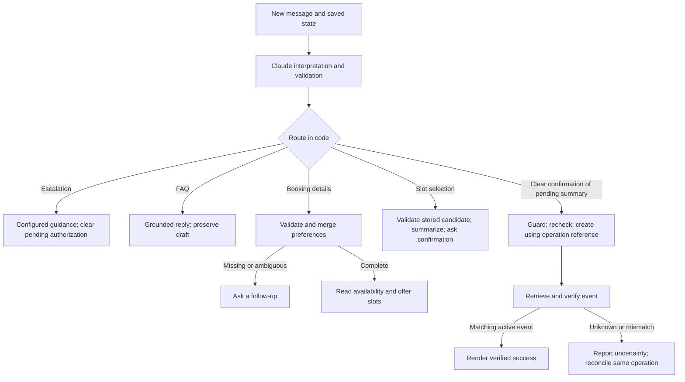

# V2 — Scheduling Scope and Acceptance Checklist

**Status: V2 in progress, not complete.** Confirmed on 2026-11-16: implement scheduling in
ordinary Python in V2; introduce LangGraph at the start of V3, followed by PostgreSQL and
multi-agent orchestration. This restores the sequence in the roadmap, project context,
architecture handoff, README, CLAUDE.md, and V1 decisions. It supersedes the LangGraph-in-V2
proposal recorded in `c2708cc`; that proposal did not add any application functionality.

### Implementation progress

- **Complete:** typed in-memory conversation state (step 1.1), validated booking intent and
  workflow stages (step 1.2), and configured service extraction with keep/set/clear updates
  (step 2.1, `6ff4ed3`). Each Claude request receives the saved stage/service explicitly
  (`43eb391`). The latest code verification passed 96 offline tests and Ruff checks.
- **Partial:** structured appointment preferences. Only the service is extracted; dentist,
  date, time, compatibility, and completeness checks remain to be implemented.
- **Not started:** CalendarService, availability, slot selection, confirmation, booking,
  verification, duplicate protection, Google Calendar integration, and V2 release validation.
- **Next small implementation step:** extract a dentist preference and validate compatibility
  with the selected service, preserving the existing API and booking limitation.

V1 remains the completed release tagged `v1.0` at `50cc705`, with package/API versions
`1.0.0` and 64 release tests. Committing V2 work does not complete or release V2.

## Goal

Retain the V1 Streamlit interface and FastAPI chat contract while adding an explicit Python
scheduling workflow that can book a new appointment through a CalendarService. Start with
an in-memory mock, then demonstrate the same journey against dedicated Google Calendar test calendars.

The patient supplies preferences, sees checked slots, selects one, confirms its exact details,
and receives a success reply only after the backend creates and verifies the calendar event.

V2 continues in this codebase on `main`. The completed V1 snapshot remains at `v1.0`
(`50cc705`, package/API `1.0.0`). No separate `v2/` application is needed.

## Retain from V1

- Streamlit remains a thin HTTP client, including its new-conversation action.
- `POST /chat` accepts `conversation_id` and `message`, returning `conversation_id` and `reply`.
  Slot selection and confirmation happen through chat; new frontend controls are unnecessary.
- ConversationService remains the channel-independent application entry point.
- Claude uses the official SDK through our provider-neutral LLMClient boundary.
- FAQs use validated clinic facts; replies support Portuguese and English.
- Claude returns a validated contextual escalation decision; backend code selects configured
  guidance. There is no keyword-based symptom detector.
- Ordinary tests stay offline. Credentials and personal `temp/` notes remain untracked.

## Proposed release boundary

| Topic | V2 proposal | Reason |
|---|---|---|
| Patient journey | Create new, single appointments; one active booking draft per conversation | Keeps the first workflow understandable |
| Orchestration | Ordinary Python functions with explicit stages and allowed transitions; no LangGraph | Learn the scheduling rules before introducing a workflow framework |
| State | Typed, in-memory conversation state keyed by `conversation_id` | Track transactional fields explicitly before graph migration and durable storage in V3 |
| Extraction | Validated intent and appointment preferences, including corrections and missing details | Avoid repeatedly inferring transactional state from chat text |
| Calendar | One CalendarService contract; mock first, Google adapter afterward | Separate workflow rules from provider behavior |
| Scheduling facts | Existing configured services, eligible dentists, durations, hours, and timezone | Prevent invented operational rules |
| Calendar layout | A dedicated test calendar for each enabled dentist | A busy interval then identifies which dentist is occupied |
| Patient identity | Generated demo booking reference; no identity verification, phone, or email required | V2 demonstrates scheduling using fictional data |
| Booking authority | Backend validates proposals and gates all calendar writes | An LLM decision alone cannot authorize a booking |
| Runtime | One local API process; serialize turns per conversation and booking attempts per dentist | Bound concurrent actions without distributed infrastructure |

The calendar layout and generated-reference choice are recommendations to review before
their implementation. A calendar event is the V2 booking record; in-memory conversation state
records workflow progress and is not a durable appointment database.

## Why Python first, LangGraph in V3

V2's bounded scheduling journey can be expressed with typed state, ordinary functions, and
conditional transitions. Learn and test preference collection, slot search, confirmation,
availability rechecking, verification, and duplicate protection in that form first. Those
booking rules must be implemented with or without a workflow framework.

At the start of V3, migrate the working flow into LangGraph while preserving its behavior
and tests. Compare the Python and graph implementations before adding PostgreSQL checkpoints,
business records, and restart recovery, then introduce multi-agent orchestration. Keep each
learning step separate. V2 has no graph checkpoints, database, or autonomous tool loop.

## Request flow and responsibilities

```text
Streamlit -> POST /chat -> ConversationService -> Python scheduling workflow
                                                  |
                            LLMClient -> Claude -> validated interpretation
                                                  |
                            escalation -> configured guidance; no booking write
                            FAQ        -> grounded answer
                            scheduling -> validate preferences and workflow state
                                                  |
                                      CalendarService (mock / Google)
                                                  |
                                  save actual reply and conversation state
                                                  |
                            ConversationService -> API response -> Streamlit
```

Claude interprets language: intent, requested service/dentist, dates, corrections, and whether
the latest message clearly confirms the pending offer. Code checks configured IDs, resolves
allowed transitions, calculates slots, and executes calendar operations. Structured output
validates shape; it does not prove that the interpretation or confirmation judgment is correct.

Start by extending the existing combined interpretation/escalation response rather than
adding a separate classifier call. The adapter's internal schema can evolve without adding
fields to the public chat API. Keep SDK-specific objects inside the adapter.

ConversationService keeps one typed state per conversation in its `_states` dictionary,
containing accepted messages and scheduling fields. Evolve that state without duplicating
histories. Keep per-turn input and unvalidated proposals separate from accepted preferences.
Each HTTP request runs a bounded portion of the workflow and returns a reply. When more
patient input is needed, save the pending stage and end the request; continue from the saved
stage on the next message. A request does not remain open while waiting for confirmation.

Failed interpretation must preserve accepted history and preferences, as it does today.
Validate proposals before applying state updates, and test failure followed by the next
request. Once calendar writes exist, preserve their operation/outcome even if a later step
fails. Retrying the workflow must never erase a write attempt or bypass duplicate protection.

Calendar methods are tools: ordinary typed functions called by workflow functions after
validation. Start with controlled dispatch from structured proposals, without an autonomous
tool loop or a second agent. Python code manages transitions; CalendarService performs I/O.

Conceptual routes across turns, not a fixed implementation schema:



Every reply ends the current request. Stale slots require new offers and confirmation;
calendar errors produce an honest failure/uncertainty reply. No route may skip the guards
described below, and escalation takes priority over every scheduling route before a write.

### Existing Python foundation: step 1.2

The same Claude call returns `escalation`, `language`, `intent`, and `reply`. The new intent
is `booking` for a new appointment request or its follow-up, and `other` otherwise. The adapter
rejects missing or invalid intent values as LLMError, using the existing HTTP 503 behavior.
The public response still contains only `conversation_id` and the final `reply`.

Python applies these transitions after a usable decision and reply are available:

| Current stage | Validated decision | Resulting stage |
|---|---|---|
| Either | Urgent or emergency escalation, regardless of intent | `chatting`; return configured guidance |
| Either | No escalation, `booking` | `collecting_preferences` |
| `chatting` | No escalation, `other` | `chatting` |
| `collecting_preferences` | No escalation, `other` (for example a clinic FAQ) | `collecting_preferences` |

Failed interpretations leave the existing stage and messages unchanged. Logs include intent
and resulting stage without patient text. New opt-in evaluation reports also record intent;
historical reports remain unchanged. Offline tests verify the adapter and transitions using
fakes; they do not establish the real model's intent accuracy.

Step 1.2 verification: 74 offline tests, Ruff lint/format checks, and whitespace checks passed.
An offline demonstration using the real adapter and service with a stub SDK confirmed
booking → preference collection, FAQ → preserved collection, and emergency → configured
guidance with the stage reset to chatting. No live model evaluation was run for this step.

At step 1.2, `collecting_preferences` recorded a pending stage; preferences were discussed
through ordinary chat history, without structured extraction or completeness checks. Draft
abandonment and later confirmation stages remain future work. The assistant still explains
that it cannot check availability or book appointments.

### Existing implementation: step 2.1

The same structured Claude response now also requires `service_update`, validated by
`ServicePreferenceUpdate` in `app/schemas/appointment.py`. The proposal is an action plus
a nullable service ID:

| Action | `service_id` | Meaning |
|---|---|---|
| `keep` | `null` | This message does not change the choice |
| `set` | Configured service ID, for example `cleaning` | Select or correct the choice |
| `clear` | `null` | Explicitly remove a previous choice or replace it with an unclear/unsupported request |

Explicit actions distinguish no new information from removal. The prompt supplies configured
service IDs alongside their display names, tells Claude to propose updates from the current
message, and prohibits exposing IDs to patients or inferring procedures from symptoms.

ConversationService now receives the already-loaded ClinicConfig through constructor injection.
On non-escalating booking turns it checks a proposed ID against configured services before
applying the update to `ConversationState.service_id`. A well-formed but unknown ID becomes
LLMError/HTTP 503 without changing the existing history, stage, or choice; the error does not
include the proposed ID. Invalid update shapes are rejected at the adapter boundary.

Non-booking turns preserve the choice, even if a model proposes a change. Escalation takes
priority over the proposal, clears the stored choice, resets the stage, and returns configured
guidance. Failed LLM calls preserve existing state. There is no keyword-based extraction.

New opt-in evaluation reports record JSON-serializable service proposals; ordinary logs do not
record service choices or patient text. Historical reports remain unchanged. Step 2.1 has
91 passing offline tests plus passing Ruff and whitespace checks. An offline adapter/service
demonstration verifies set, keep, correction, and clear; no live model evaluation was run.

This slice extracts only the requested service. Dentist matching, dates/times, deterministic
completeness checks, and associated follow-up handling remain later steps. The public API,
Streamlit interface, and booking limitation remain unchanged.

#### Step 2.1 improvement: explicit state in the LLM request

`build_turn_prompt()` in `app/prompts/system_prompt.py` appends a Current backend workflow
state section to the startup prompt for each request. Its JSON contains only
`current_workflow_state.stage` and `current_workflow_state.service_id`, taken from saved state
before the latest message is processed. The full state object is not serialized, and message
history is still passed separately in the existing provider-neutral messages list.

The prompt tells Claude to use this snapshot as the current stored preference, use history
for dialogue context and unresolved concerns, and propose any new change from the latest
message. A cleared choice remains null even when older messages mention a service. Patient
text imitating a state section stays in patient messages; code never promotes it into the
backend state section. Python still validates proposals and controls state changes.

The startup prompt is not mutated or accumulated between requests. Each snapshot reflects
only that conversation, including successful corrections, clearing, and escalation resets;
failed turns do not alter the next snapshot. New opt-in evaluation reports save the exact
per-turn system prompt, while their top-level `system_prompt` remains the startup/base prompt.
Historical reports remain unchanged. No new LLM call is introduced.

Verification: 96 offline tests plus passing Ruff and whitespace checks. Tests cover changing
snapshots, conversation isolation, separation of patient text, rejected updates, escalation
resets, and per-turn evaluation evidence. No live model evaluation was run for this improvement.

## Scheduling journey

1. **Collect preferences.** Extract the configured service, preferred dentist or no preference,
   date/date range, and time/time window. Ask only for missing or ambiguous details. Merge
   corrections deliberately; an omitted field must not erase a previously supplied value.
2. **Validate and search.** Check service/dentist compatibility, a future bounded date window,
   clinic hours, configured duration, and timezone. Read busy intervals and compute slots
   that fit completely within opening hours without overlap. Calendar read errors do not
   mean the calendar is empty.
3. **Offer slots.** Show a small set of checked candidates with dentist, service, full date,
   start/end time, and clinic timezone. A suggested slot is not reserved.
4. **Select and summarize.** Resolve a selection against the stored candidates. Present one
   exact booking summary and ask explicitly whether to book it. Selecting an option does
   not itself create an event, even if the initial request said "book it."
5. **Confirm.** Accept a clear affirmative only while awaiting confirmation for that summary.
   An ambiguous answer gets a clarification. A refusal abandons the draft without a write.
   A changed service, dentist, date, or time invalidates confirmation and requires a new summary.
   Bind authorization to the stored proposal revision and exact details. A model's affirmative
   label is only an interpretation: code must also require the awaiting-confirmation stage,
   an unchanged pending summary, no conflicting preference update, and no escalation. A message
   such as "yes, but at 3 instead" changes the proposal and cannot authorize the earlier slot.
6. **Recheck and create.** Under the local booking guard, revalidate the selected slot and
   read availability immediately before creating. If it became busy, offer fresh alternatives
   and require selection and confirmation again; never silently substitute another slot.
7. **Verify and report.** Read back the event and match its operation reference, dentist/calendar,
   service, and start/end times. Only a matching active event permits a booking-success reply.
   Use backend-rendered booking outcomes so a later LLM failure cannot obscure a completed write.

Keep transactional fields explicit: preferences, candidates, selected slot, pending summary,
confirmation state, workflow stage, booking operation reference, event ID, and verified result.
The exact Python schema and function boundaries will be introduced in small implementation steps.

Relative dates such as "tomorrow" use an injected current time in the configured clinic
timezone, with fixed clocks in tests. Ambiguous dates require clarification. The current
clinic YAML says `America/Sao_Paulo`; V2 must not silently replace it with the user's timezone.
Review that existing choice before calendar integration. Search horizon, time-window meanings,
slot spacing, and result count must be explicit demo settings, not model-invented clinic facts.

An unrelated FAQ can preserve the draft, but its answer cannot act as a booking confirmation.
Escalation takes precedence over scheduling, clears pending authorization, and returns the
configured guidance without a write. Returning to scheduling requires a fresh summary and
confirmation. Abandoning a draft never cancels an already created event.

## CalendarService and booking guarantees

The minimum capabilities are: read busy intervals, create an event with a stable operation
reference, and retrieve an event to verify/reconcile it. The mock must model shared busy
intervals and failures, including "event created but response lost," rather than always
returning success. Deterministic scheduling code applies clinic rules in both modes.

- Generate a server-owned operation reference for the exact booking proposal before writing.
  Repeated confirmation, request retries, or workflow retries reuse that reference. They must
  not generate another event for the same operation.
- Calendar write functions must be safe if invoked again with the same operation. In-memory
  workflow state is not proof that an external write happened exactly once; reconcile provider
  state before any retry after an uncertain outcome.
- Keep in-progress, verified, definitely failed, and unknown outcomes distinct. A timeout
  after submission is an unknown outcome, not evidence that creation failed.
- Reconcile an unknown result using the same event/operation reference. Until resolved,
  block replacement booking writes in that conversation and explain the uncertainty.
  Never retry with a fresh reference just because verification failed.
- A repeated confirmation after verified success returns the known result. It cannot start
  another booking unless the patient explicitly begins a new appointment request.
- Protect the recheck/create sequence against competing requests inside the single API
  process. Two conversations must not both book the same dentist's overlapping slot there.

For Google, use an explicit dentist-to-test-calendar mapping and an event ID derived from
the operation reference, following Google's ID rules. Retrieve and validate an existing
event when recovering the same operation. Use free/busy reads for occupied intervals;
Google does not supply the clinic's appointment-slot rules.

These are bounded V2 guarantees. In-memory conversation state and operation tracking disappear on
restart; existing Google events remain. A new conversation is not a verified patient identity,
so cross-conversation duplicate patient requests are not reliably identifiable. Google
availability reads and event creation are separate operations; local locks cannot exclude
another calendar writer. V2 does not promise atomic reservations, exactly-once delivery,
multi-worker coordination, or automatic restart recovery. Document manual reconciliation
for uncertain writes after a restart; durable recovery belongs to V3.

## Google Calendar phase

Only begin after the mock journey and failure cases work. Use dedicated test calendars
and fictional data, with local developer authorization and credentials outside Git. Do not
default to the account's primary calendar or send invitations, emails, or reminders.

Choose and document the authorization flow/scopes during this phase. The Google adapter
must satisfy the same CalendarService behavior without changing the workflow or public API.
Keep live checks opt-in and outside ordinary pytest execution; document how to inspect and
remove only events created by a test run. Mock mode remains runnable without Google credentials.

## Out of scope

- V3: LangGraph migration, PostgreSQL, durable checkpoints/business records, patient
  verification, appointment lookup for returning patients, rescheduling/cancellation,
  and multi-agent orchestration.
  Internal event retrieval for V2 verification is not a patient-facing lookup feature.
- V4: WhatsApp, Redis/Celery, Docker, cloud deployment, and operational messaging/reminders.
- RAG, MCP, payments, medical records, staff dashboards, recurring/group appointments,
  resource/chair scheduling, and a full dentist shift/holiday management system.
- Production patient use, distributed booking guarantees, and clinical validation.

## Learning steps

Each item is a milestone to split further when necessary. Implement one understandable
step, explain its request/data flow, verify it, and stop for review.

0. **Sequence confirmed:** Python scheduling in V2; LangGraph, PostgreSQL, and multi-agent
   orchestration in V3, in that order. Calendar layout and patient-reference proposals remain
   for review before their own implementation steps.
1. **Complete:** introduce typed in-memory conversation state (step 1.1) and explicit Python
   workflow stages driven by validated booking intent (step 1.2), behind ConversationService.
   Existing tests verify history, isolation, FAQ behavior, escalation, and failed-turn handling.
2. **In progress:** structured preference extraction, validation, corrections, and missing-detail
   questions. Step 2.1 extracts and validates the service; its follow-up supplies saved stage
   and service explicitly to Claude. Next, add dentist preference and compatibility, then
   date/date range and time/time window, one field at a time. Preserve keep/set/clear semantics,
   including the difference between an unspecified dentist and an explicit "any dentist."
   Add deterministic completeness checks and missing-detail questions in separate slices.
3. Add mock CalendarService reads and slot calculation; demonstrate real mock-backed offers.
4. Add selection, exact summary, confirmation, refusal, and draft abandonment with no writes yet.
5. Add guarded mock booking, recheck, read-back verification, repeat protection, and unknown-result
   handling. Introduce these in separate reviewable slices before enabling Google writes.
6. Add Google test-calendar authorization and read-only availability, then enable the same
   confirmed/verified write path and run opt-in integration checks.
7. Record fictional end-to-end evaluations, decisions, limitations, and setup; verify a clean
   checkout before a separately authorized V2 release/tag.

No commits, pushes, or release tags are authorized by this plan.

## Acceptance checklist

- [ ] Streamlit and the existing chat/health API remain usable; FAQs, language, conversation
  isolation, new-conversation behavior, and configured escalation continue working.
- [ ] Typed conversation state persists between turns in the same process without LangGraph
  or graph checkpoints; restart limitations are demonstrated and documented.
- [ ] Python workflow transitions preserve service updates, state context, FAQ/escalation behavior,
  isolation, and accepted-state preservation after failed turns.
- [ ] Preferences are extracted and corrected in Portuguese and English; ambiguous dates,
  missing details, unsupported services, and incompatible dentists get clarification.
- [ ] Only future, non-overlapping slots fitting configured hours, duration, and dentist
  eligibility are offered; empty results and read failures have distinct replies.
- [ ] Selection alone, vague consent, refusal, changed preferences, escalation, and attempts
  to bypass confirmation cannot trigger creation.
- [ ] A confirmed mock appointment is rechecked, created, retrieved, and verified before success.
- [ ] A slot taken after the offer causes fresh alternatives and fresh confirmation.
- [ ] Repeated/concurrent confirmations and concurrent competing conversations satisfy the
  documented single-process duplicate and overlap protections.
- [ ] Definite write failure and creation-with-lost-response are exercised; verification
  failure cannot produce false success or a blind replacement booking.
- [ ] A lost HTTP reply followed by a retry returns the verified booking without another event.
- [ ] The same journey works from Streamlit against Google test calendars; inspect the matching
  event and verify repeated confirmation leaves one event for that operation.
- [ ] Offline tests require neither API keys nor network; live LLM/calendar checks are opt-in.
  Behavioral evaluations use declared functional expectations; style judgments stay advisory.
- [ ] README and V2 decisions explain setup, mock/live modes, request flow, credentials,
  demo configuration, cleanup, and limitations; dependencies install from a clean checkout.

## References

Agreed project direction: [four-version roadmap](../documents/02_FOUR_VERSION_ROADMAP.md) and
[V1 handoff](v1-decisions.md#v2-handoff). V2 uses Python scheduling; V3 introduces LangGraph
before durable PostgreSQL state and multi-agent orchestration.

Provider mechanics checked while drafting: [Google free/busy](https://developers.google.com/workspace/calendar/api/v3/reference/freebusy/query),
[event creation and custom IDs](https://developers.google.com/workspace/calendar/api/guides/create-events),
and [event retrieval](https://developers.google.com/workspace/calendar/api/v3/reference/events/get).
These explain provider operations; the confirmation and safety rules above are our design choices.
