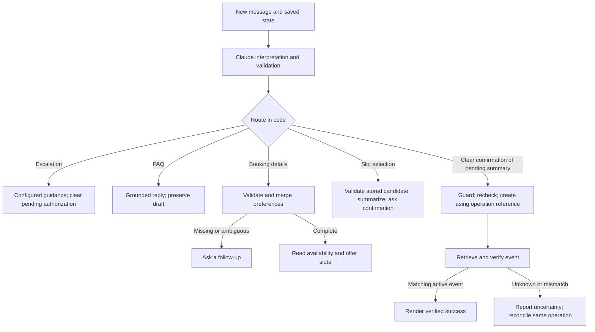

# V2 — Scheduling Scope and Acceptance Checklist

**Status: V2 in progress, not complete.** Confirmed on 2026-11-16: implement scheduling in
ordinary Python in V2; introduce LangGraph at the start of V3, followed by PostgreSQL and
multi-agent orchestration. This restores the sequence in the roadmap, project context,
architecture handoff, README, CLAUDE.md, and V1 decisions. It supersedes the LangGraph-in-V2
proposal recorded in `c2708cc`; that proposal did not add any application functionality.

### Implementation progress

- **Complete:** typed in-memory conversation state (step 1.1), validated booking intent and
  workflow stages (step 1.2), and configured service extraction with keep/set/clear updates
  (step 2.1, `6ff4ed3`). Each Claude request receives the saved stage/service explicitly
  (`43eb391`). Step 2.2 (`eb406a9`) adds dentist preference extraction and configured compatibility checks,
  including corrections and the distinction between unanswered and any eligible dentist.
  Step 2.3 adds dates/date ranges, explicit clinic-clock context, corrections, clearing, and
  past-date validation. Step 2.4 adds time periods, exact times, inclusive windows, explicit
  any time, corrections, and elapsed-time validation for today-only dates. Step 2.5 adds
  deterministic preference completeness and compatibility assessment. Step 2.6 adds localized
  backend questions for the first missing detail. Step 3.1 adds a read-only CalendarService
  and mock busy-interval reads with a standalone offline demonstration. Step 3.2 adds bounded
  slot calculation through that interface with explicit demo settings and an offline demo.
  Step 3.3 connects mock availability to chat and stores/displays checked candidate options.
  A subsequent refactor separates conversation orchestration, scheduling decisions, and
  preference resolution without changing behavior. Step 4.1 adds selection against saved offers,
  exact summaries, and slot_selected state without confirmation or writes. The latest verification
  passed 476 offline tests and Ruff checks, plus an eight-turn scripted HTTP demonstration.
- **Implemented preference collection:** service/dentist/date/time extraction, validation,
  completeness assessment, and backend missing-detail questions. Ambiguous clear proposals
  preserve model-generated clarifications; real-model interpretation accuracy remains unproven.
- **Partial:** CalendarService has a read contract and working in-memory mock; AvailabilityService
  calculates exact slots using clinic rules/preferences and busy reads. Chat now shows/stores
  checked mock options with distinct no-slot/search-error/read-error replies and can retain one
  exact selected option. Calendar write/verification operations remain to be implemented.
- **Not started:** confirmation/refusal/abandonment handling, booking,
  verification, duplicate protection, Google Calendar integration, and V2 release validation.
- **Next small implementation step:** confirmation/refusal/abandonment handling bound to the
  exact selected summary, with no writes. Guarded mock booking follows; the public API remains
  unchanged. Selection alone or a bare affirmative cannot create an event in the current code.

V1 remains the completed release tagged `v1.0` at `50cc705`, with package/API versions
`1.0.0` and 64 release tests. Committing V2 work does not complete or release V2.

## Goal

Retain the V1 Streamlit interface and FastAPI chat contract while adding an explicit Python
scheduling workflow that can book a new appointment through a CalendarService. Start with
an in-memory mock, then demonstrate the same journey against dedicated Google Calendar test calendars.

The patient supplies preferences, sees checked slots, selects one, confirms its exact details,
and receives a success reply only after the backend creates and verifies the calendar event.

V2 continues in this codebase on `main`. The completed V1 snapshot remains at `v1.0`
(`50cc705`, package/API `1.0.0`). No separate `v2/` application is needed.

## Retain from V1

- Streamlit remains a thin HTTP client, including its new-conversation action.
- `POST /chat` accepts `conversation_id` and `message`, returning `conversation_id` and `reply`.
  Slot selection and confirmation happen through chat; new frontend controls are unnecessary.
- ConversationService remains the channel-independent application entry point.
- Claude uses the official SDK through our provider-neutral LLMClient boundary.
- FAQs use validated clinic facts; replies support Portuguese and English.
- Claude returns a validated contextual escalation decision; backend code selects configured
  guidance. There is no keyword-based symptom detector.
- Ordinary tests stay offline. Credentials and personal `temp/` notes remain untracked.

## Proposed release boundary

| Topic | V2 proposal | Reason |
|---|---|---|
| Patient journey | Create new, single appointments; one active booking draft per conversation | Keeps the first workflow understandable |
| Orchestration | Ordinary Python functions with explicit stages and allowed transitions; no LangGraph | Learn the scheduling rules before introducing a workflow framework |
| State | Typed, in-memory conversation state keyed by `conversation_id` | Track transactional fields explicitly before graph migration and durable storage in V3 |
| Extraction | Validated intent and appointment preferences, including corrections and missing details | Avoid repeatedly inferring transactional state from chat text |
| Calendar | One CalendarService contract; mock first, Google adapter afterward | Separate workflow rules from provider behavior |
| Scheduling facts | Existing configured services, eligible dentists, durations, hours, and timezone | Prevent invented operational rules |
| Calendar layout | A dedicated test calendar for each enabled dentist | A busy interval then identifies which dentist is occupied |
| Patient identity | Generated demo booking reference; no identity verification, phone, or email required | V2 demonstrates scheduling using fictional data |
| Booking authority | Backend validates proposals and gates all calendar writes | An LLM decision alone cannot authorize a booking |
| Runtime | One local API process; serialize turns per conversation and booking attempts per dentist | Bound concurrent actions without distributed infrastructure |

The calendar layout and generated-reference choice are recommendations to review before
their implementation. A calendar event is the V2 booking record; in-memory conversation state
records workflow progress and is not a durable appointment database.

## Why Python first, LangGraph in V3

V2's bounded scheduling journey can be expressed with typed state, ordinary functions, and
conditional transitions. Learn and test preference collection, slot search, confirmation,
availability rechecking, verification, and duplicate protection in that form first. Those
booking rules must be implemented with or without a workflow framework.

At the start of V3, migrate the working flow into LangGraph while preserving its behavior
and tests. Compare the Python and graph implementations before adding PostgreSQL checkpoints,
business records, and restart recovery, then introduce multi-agent orchestration. Keep each
learning step separate. V2 has no graph checkpoints, database, or autonomous tool loop.

## Request flow and responsibilities

```text
Streamlit -> POST /chat -> ConversationService -> Python scheduling workflow
                                                  |
                            LLMClient -> Claude -> validated interpretation
                                                  |
                            escalation -> configured guidance; no booking write
                            FAQ        -> grounded answer
                            scheduling -> validate preferences and workflow state
                                                  |
                                      CalendarService (mock / Google)
                                                  |
                                  save actual reply and conversation state
                                                  |
                            ConversationService -> API response -> Streamlit
```

Claude interprets language: intent, requested service/dentist, dates, corrections, and whether
the latest message clearly confirms the pending offer. Code checks configured IDs, resolves
allowed transitions, calculates slots, and executes calendar operations. Structured output
validates shape; it does not prove that the interpretation or confirmation judgment is correct.

Start by extending the existing combined interpretation/escalation response rather than
adding a separate classifier call. The adapter's internal schema can evolve without adding
fields to the public chat API. Keep SDK-specific objects inside the adapter.

ConversationService keeps one typed state per conversation in its `_states` dictionary,
containing accepted messages and scheduling fields. Evolve that state without duplicating
histories. Keep per-turn input and unvalidated proposals separate from accepted preferences.
Each HTTP request runs a bounded portion of the workflow and returns a reply. When more
patient input is needed, save the pending stage and end the request; continue from the saved
stage on the next message. A request does not remain open while waiting for confirmation.

Failed interpretation must preserve accepted history and preferences, as it does today.
Validate proposals before applying state updates, and test failure followed by the next
request. Once calendar writes exist, preserve their operation/outcome even if a later step
fails. Retrying the workflow must never erase a write attempt or bypass duplicate protection.

Calendar methods are tools: ordinary typed functions called by workflow functions after
validation. Start with controlled dispatch from structured proposals, without an autonomous
tool loop or a second agent. Python code manages transitions; CalendarService performs I/O.

Conceptual routes across turns, not a fixed implementation schema:



Every reply ends the current request. Stale slots require new offers and confirmation;
calendar errors produce an honest failure/uncertainty reply. No route may skip the guards
described below, and escalation takes priority over every scheduling route before a write.

### Existing Python foundation: step 1.2

The same Claude call returns `escalation`, `language`, `intent`, and `reply`. The new intent
is `booking` for a new appointment request or its follow-up, and `other` otherwise. The adapter
rejects missing or invalid intent values as LLMError, using the existing HTTP 503 behavior.
The public response still contains only `conversation_id` and the final `reply`.

Python applies these transitions after a usable decision and reply are available:

| Current stage | Validated decision | Resulting stage |
|---|---|---|
| Either | Urgent or emergency escalation, regardless of intent | `chatting`; return configured guidance |
| Either | No escalation, `booking` | `collecting_preferences` |
| `chatting` | No escalation, `other` | `chatting` |
| `collecting_preferences` | No escalation, `other` (for example a clinic FAQ) | `collecting_preferences` |

Failed interpretations leave the existing stage and messages unchanged. Logs include intent
and resulting stage without patient text. New opt-in evaluation reports also record intent;
historical reports remain unchanged. Offline tests verify the adapter and transitions using
fakes; they do not establish the real model's intent accuracy.

Step 1.2 verification: 74 offline tests, Ruff lint/format checks, and whitespace checks passed.
An offline demonstration using the real adapter and service with a stub SDK confirmed
booking → preference collection, FAQ → preserved collection, and emergency → configured
guidance with the stage reset to chatting. No live model evaluation was run for this step.

At step 1.2, `collecting_preferences` recorded a pending stage; preferences were discussed
through ordinary chat history, without structured extraction or completeness checks. Draft
abandonment and later confirmation stages remain future work. The assistant still explains
that it cannot check availability or book appointments.

### Existing implementation: step 2.1

The same structured Claude response now also requires `service_update`, validated by
`ServicePreferenceUpdate` in `app/schemas/appointment.py`. The proposal is an action plus
a nullable service ID:

| Action | `service_id` | Meaning |
|---|---|---|
| `keep` | `null` | This message does not change the choice |
| `set` | Configured service ID, for example `cleaning` | Select or correct the choice |
| `clear` | `null` | Explicitly remove a previous choice or replace it with an unclear/unsupported request |

Explicit actions distinguish no new information from removal. The prompt supplies configured
service IDs alongside their display names, tells Claude to propose updates from the current
message, and prohibits exposing IDs to patients or inferring procedures from symptoms.

ConversationService now receives the already-loaded ClinicConfig through constructor injection.
On non-escalating booking turns it checks a proposed ID against configured services before
applying the update to `ConversationState.service_id`. A well-formed but unknown ID becomes
LLMError/HTTP 503 without changing the existing history, stage, or choice; the error does not
include the proposed ID. Invalid update shapes are rejected at the adapter boundary.

Non-booking turns preserve the choice, even if a model proposes a change. Escalation takes
priority over the proposal, clears the stored choice, resets the stage, and returns configured
guidance. Failed LLM calls preserve existing state. There is no keyword-based extraction.

New opt-in evaluation reports record JSON-serializable service proposals; ordinary logs do not
record service choices or patient text. Historical reports remain unchanged. Step 2.1 has
91 passing offline tests plus passing Ruff and whitespace checks. An offline adapter/service
demonstration verifies set, keep, correction, and clear; no live model evaluation was run.

This slice extracts only the requested service. Dentist matching, dates/times, deterministic
completeness checks, and associated follow-up handling remain later steps. The public API,
Streamlit interface, and booking limitation remain unchanged.

#### Step 2.1 improvement: explicit state in the LLM request

At step 2.1, `build_turn_prompt()` in `app/prompts/system_prompt.py` appends a Current backend workflow
state section to the startup prompt for each request. Its JSON contains only
`current_workflow_state.stage` and `current_workflow_state.service_id`, taken from saved state
before the latest message is processed. The full state object is not serialized, and message
history is still passed separately in the existing provider-neutral messages list.

The prompt tells Claude to use this snapshot as the current stored preference, use history
for dialogue context and unresolved concerns, and propose any new change from the latest
message. A cleared choice remains null even when older messages mention a service. Patient
text imitating a state section stays in patient messages; code never promotes it into the
backend state section. Python still validates proposals and controls state changes.

The startup prompt is not mutated or accumulated between requests. Each snapshot reflects
only that conversation, including successful corrections, clearing, and escalation resets;
failed turns do not alter the next snapshot. New opt-in evaluation reports save the exact
per-turn system prompt, while their top-level `system_prompt` remains the startup/base prompt.
Historical reports remain unchanged. No new LLM call is introduced.

Verification: 96 offline tests plus passing Ruff and whitespace checks. Tests cover changing
snapshots, conversation isolation, separation of patient text, rejected updates, escalation
resets, and per-turn evaluation evidence. No live model evaluation was run for this improvement.

### Foundation: step 2.2

The same Claude call also requires `dentist_update`, validated by `DentistPreferenceUpdate`.
Actions are keep, set, clear, and any; only set carries a configured dentist ID. Keep preserves
the saved preference, clear makes it unanswered again, and any records the patient's explicit
acceptance of any eligible dentist. The backend does not infer a preference just because only
one dentist offers the service. Configured dentist IDs and names are supplied in the prompt.

`ConversationState.dentist_preference` is an immutable `DentistPreference` with kind
unspecified, specific, or any and a nullable dentist_id. Its validator requires an ID only for
specific. The per-turn state snapshot now includes this object alongside stage and service_id;
history remains separate. No new LLM call or public API field is introduced.

On a non-escalating booking turn, ConversationService validates both proposed IDs before
applying either update. Unknown IDs reject the turn as LLMError/HTTP 503 without changing
accepted history or preferences or exposing the ID in logs. A known dentist paired with an
incompatible service is a patient clarification, not a provider failure: both requested choices
are retained, and Python supplies a Portuguese/English reply using configured names and eligible
dentists. It asks whether to change the dentist or service and reiterates the booking limitation.
The exact reply shown is saved in history. Service labels use their configured display names.

Compatibility is checked against the merged preferences on every booking turn, including a
service-only correction, a dentist supplied before a service, or a follow-up to an unresolved
conflict. A correction, any, or clear can resolve the conflict. FAQs preserve preferences;
escalation takes priority, clears both preferences, and returns configured guidance. There is
no calendar access, availability search, appointment creation, or silent dentist reassignment.

Verification: 132 offline tests and Ruff checks passed. Cases cover validated adapter output,
preference transitions, both languages, compatibility/rechecking, unknown IDs, atomic rejection,
history, prompt snapshots, isolation, escalation, failure handling, API compatibility, and
JSON-serializable evaluation evidence. An offline demonstration through the real Claude adapter
with scripted SDK responses verified consultation with Bruno → cleaning correction → backend
clarification offering Ana → explicit any preference. It made three stub calls and no network
calls. No formal live behavior evaluation was run for this step; tests verify code with fakes.

### Foundation: step 2.3

The same structured Claude response now also requires `date_update`, with keep/set/clear
actions and a nullable date_range. Set requires a `DatePreference` containing start_date and
end_date; keep and clear require null. The range is inclusive, and a single day uses equal
endpoints. Values become Python `date` objects, not timestamps. Pydantic validates calendar
dates, rejects timestamp inputs, and requires start_date <= end_date. Invalid model output
becomes LLMError/HTTP 503 without changing accepted preferences or history.

ConversationService reads an injectable timezone-aware clock once before calling Claude,
converts it to the configured clinic timezone, and uses that request-time snapshot throughout
the turn. `build_turn_prompt()` supplies current_time (timezone, local_datetime, today) and
the saved date_preference alongside stage/service/dentist. Production defaults to the UTC
system clock; tests use fixed clocks. No new configuration or dependency is needed. The clinic
timezone remains `America/Sao_Paulo`; it is not inferred from the developer's location.

Claude resolves unambiguous relative dates using that context. Corrections replace a prior
range; keep preserves it. Clear removes a withdrawn choice or a superseded choice when the
new request is ambiguous, reversed, disjoint, or recurring; the prompt instructs Claude to ask
for the missing information or one continuous range. No natural-language date keyword parser
is added. Recognition and ambiguity handling still depend on the model's interpretation.

Python accepts today or later as date preferences. If a proposed or retained range starts
before the clinic-local current date, it clears the entire date preference and returns a
Portuguese/English clarification. It does not move the date to another week/year or shorten
a partially past range. Other valid service/dentist updates remain accepted. Date validity
is checked again on each booking turn, so a saved date can expire between messages. FAQs
preserve the draft; escalation clears all preferences. Provider failures and unknown configured
IDs preserve the whole accepted state. Reply priority is escalation, past-date clarification,
service/dentist compatibility clarification, then the model's reply; unresolved dentist
preferences remain stored when a past-date issue is addressed first.

The state snapshot and opt-in evaluation evidence serialize dates as strings. The public API
and Streamlit remain unchanged. Date validation does not inspect availability or opening hours.
Time-of-day extraction and future-time checks, bounded calendar search settings, availability,
and booking remain later steps. No default search horizon is invented in this extraction slice.

Verification: 169 offline tests, Ruff lint/format checks, and whitespace checks passed.
Coverage includes adapter schema validation, one-day/range updates, corrections and clearing,
clinic timezone/date rollover, today/past/partially past ranges, isolation, escalation,
atomic failed-turn handling, API compatibility, and JSON evaluation evidence. A four-turn
offline demonstration through the real Claude adapter with scripted SDK responses verified
tomorrow → range correction → ambiguous correction/clear → backend past-date clarification,
preserving service and dentist. No live model or calendar calls were made; these checks do
not establish the accuracy of real model date interpretation.

### Foundation: step 2.4

The same structured Claude response now also requires `time_update`, validated by
`TimePreferenceUpdate`. Actions are keep/set/clear; only set carries a `preference`.
`TimePreference` has kind, start_time, and end_time. Accepted state stores it as
`ConversationState.time_preference`; null means unanswered. An explicit any time is
`kind="any"` with null bounds. It is never inferred from a missing preference.

Kinds morning/afternoon/evening carry null bounds. Their explicit demo meanings live in
`TIME_PERIODS` in `app/schemas/appointment.py`: morning [00:00,12:00), afternoon [12:00,18:00),
and evening [18:00,end of day). The prompt receives these same values as `time_periods` on
each turn; the model does not choose their boundaries. These are application preference
semantics, not claims about clinic hours. They can move to demo configuration when scheduling
settings are introduced for slot calculation.

Kind window carries at least one inclusive bound. Equal endpoints mean an exact start time;
one null endpoint means an unbounded side within the day. The prompt represents strictly
before/after requests by moving the boundary inward by one second. Times refer to appointment
starts, not the whole service duration. Native Python `time` values and ISO local-time strings
are accepted; numeric timestamps, dates, UTC offsets, timezone suffixes, reversed/overnight
windows, inconsistent kinds/bounds, missing fields, and extra fields are rejected at the adapter
boundary as LLMError/HTTP 503. Accepted history/preferences remain unchanged after rejection.

Claude proposes updates from the current message. Time-only changes do not infer dates;
date-only changes keep the time. Ambiguous corrections (for example "at 7" without context),
disjoint alternatives, mixed period/window constraints, explicit timezone conversions, and
relative durations are instructed to clear the old preference and ask for one supported
clinic-local preference. There is no keyword time parser. This interpretation still depends
on Claude; valid structured output does not prove correct language understanding.

Python merges proposals before checking them, using the request's existing clinic-local clock.
If the merged date is only today, an exact time or window expires once its inclusive upper
bound is before now; morning/afternoon expire at their exclusive ends. Python clears only
the time and returns a Portuguese/English clarification. A partially elapsed window stays
unchanged. With no date, a future date, or a range extending to future days, the preference
remains applicable and is preserved. Keep and date corrections also recheck the retained time
on booking turns. A cleared/past date leaves time available for the replacement date. FAQs
preserve drafts, escalation clears all preferences, and failed turns are atomic.

Reply priority is escalation, past-date clarification, elapsed-time clarification, dentist
compatibility clarification, then the model reply. Other valid updates and unresolved dentist
choices remain stored even when a date/time issue is addressed first. The prompt snapshot and
opt-in evaluation evidence serialize times as strings. Public API and Streamlit are unchanged.
No opening-hour, duration, or busy-calendar checks occur yet; a valid preference is not an
available slot. Completeness checks, calendar reads, selection, confirmation, and booking remain
later work.

Verification: 243 offline tests, Ruff lint/format checks, and whitespace checks passed.
Coverage includes schema/adapter rejection, correction/clear/any, inclusive and named-period
boundaries, clinic-local clocks, retained-time expiration, date corrections, future-day ranges,
FAQ/isolation/escalation, failure preservation and recovery, API compatibility, and JSON evaluation
evidence. A five-turn offline demonstration through the real Claude adapter/service with scripted
SDK responses exercised morning → window correction → elapsed time today/backend clarification
→ explicit any time → ambiguous correction/clear, preserving service/dentist/date choices.
No live model or calendar calls were made; these checks do not establish real-model accuracy.

### Foundation: step 2.5

`assess_preferences()` in `app/services/preferences.py` is an ordinary pure Python function
over the resolved configured service and validated dentist/date/time preferences. It returns
an immutable internal `PreferenceStatus` dataclass containing missing field codes, conflict
codes, and a derived `is_complete` property. Missing fields follow service/dentist/date/time
order. A specific or explicit any dentist counts as answered; an unspecified dentist does
not, even for a service with only one eligible provider. An explicit any time, named period,
exact time, or window counts as answered. A date range is sufficient; exact slot selection
comes later. A specific dentist outside the service's configured eligible list produces
`service_dentist`. Missing fields and conflicts can coexist. Completeness requires both
collections to be empty; it neither mutates choices nor infers any preference.

ConversationService invokes the assessment after configured-ID validation, proposal merging,
past-date clearing, and elapsed-time clearing on each non-escalating booking turn. The helper
assumes those validations have already run; it is not a standalone date/time or ID validator.
The same conflict result drives the existing compatibility clarification, centralizing that
decision. The existing reply priority, stage transitions, API contract, and successful-turn
history are preserved. Complete preferences still leave the stage at collecting_preferences.
The result is recalculated each turn and is not duplicated in saved state as a readiness flag.

Normal booking logs now include preferences_complete, missing_preferences, and
preference_conflicts, using only booleans/fixed field codes. Empty collections log as `none`.
FAQ and escalation turns skip assessment and log `None` for these three values; they retain
their existing draft-preservation/reset behavior. Failed turns do not report a successful
assessment or change accepted state/history. No second Claude call, prompt/output-schema
change, backend missing-detail question, availability read, or booking operation is added.
Completeness alone establishes neither opening-hour/duration feasibility nor available slots.

Verification: 271 offline tests, Ruff lint/format checks, and whitespace checks passed. New
coverage checks each missing field, explicit any versus unanswered, periods/ranges/exact times,
configured eligibility, simultaneous missing/conflicting values, corrections/clearing,
post-rejection assessment, logs, isolation, failed-turn recovery, FAQ, and escalation. A four-turn
offline demonstration through the real Claude adapter/service with scripted SDK responses showed
missing dentist → complete with explicit any → service/dentist conflict → missing time after
clearing, while the stage remained collecting_preferences. No live model/calendar calls were made.

### Foundation: step 2.6

`missing_preference_reply()` in `app/services/preferences.py` selects a Portuguese/English
question from the first missing field in PreferenceStatus. Service/dentist/date/time order
is deterministic. It returns no generic question for a complete or conflicting draft. The
dentist question receives names from the selected service's configured eligible IDs and
explicitly offers any eligible provider, including when only one provider is eligible.
The time question explicitly offers any time. Answered preferences are not requested again.

ConversationService uses this question on ordinary incomplete booking turns, after merging
and validating the current proposals. Reply priority is escalation,
past-date clarification, elapsed-time clarification, dentist compatibility clarification,
missing-detail question, then generated reply. An explicit clear proposal for any preference
skips the generic question, preserving the model's specific ambiguity/withdrawal clarification
unless higher-priority guidance applies. Clear does not distinguish withdrawal from ambiguity;
this preserves both within the existing schema. A later keep turn resumes generic collection.
Complete drafts retain the usual generated summary/phone and collecting_preferences stage;
there is still no availability check or booking.

The existing single Claude call now also returns nullable `booking_answer` in its internal
AssistantDecision/LLMResult. For mixed clinic-question/booking messages, the prompt instructs
Claude to put a concise grounded clinic answer there, without follow-up questions or booking
claims. When using a backend collection question, Python prepends any nonempty booking_answer
with a blank line; other routes keep their existing replies. This preserves a clinic answer
while the backend controls which missing detail is requested. The adapter validates the field's
presence/type, and evaluation evidence records it. Content accuracy still depends on Claude.

The actual backend question is saved in history, returned through the unchanged API, and
recorded by the evaluation runner. Standalone FAQs preserve the draft and generated answer.
Failed turns preserve accepted state/history, escalation clears preferences, and conversations
remain isolated. No second model call or keyword parser is added. Complete/clear replies must
include any required clinic answer in their normal reply as instructed in the prompt; higher
priority validation/escalation guidance remains authoritative.

Verification: 306 offline tests, Ruff lint/format checks, and whitespace checks passed.
Coverage includes PT/EN question order, details supplied early, configured eligibility/name
changes, sole-provider behavior, explicit any, complete drafts, clear clarifications, reply
priority, FAQ, escalation, failed-turn recovery, isolation, API compatibility, actual saved
history, mixed clinic-answer composition, adapter transport, and evaluation replies. Older
preference tests now expect backend questions instead of placeholder model text on incomplete
turns. An eight-turn offline demonstration through the real Claude adapter/service with scripted
SDK responses exercised all four missing questions, a mixed price inquiry, complete-draft
fallback, a standalone FAQ, ambiguous correction, and elapsed-time priority. No live model/calendar
calls were made; interpretation and specific model clarifications remain model-dependent.

### Foundation: step 3.1

`CalendarService` in `app/services/calendar.py` introduces a provider-neutral read boundary,
using the same abstract-base-class pattern as LLMClient. Its only current method is
`get_busy_intervals(dentist_id, window)`. A future Google adapter will implement the same
read contract; event creation and retrieval will be introduced with their workflow steps,
without placeholder write methods in this slice.

`TimeInterval` in `app/schemas/calendar.py` represents a concrete query window or busy period.
It requires aware Python datetimes or aware ISO datetime strings, normalizes to UTC before
comparing instants, and requires start < end. Naive values, date-only values, numeric timestamps,
empty/reversed intervals, and extra fields are rejected. Values are immutable. Intervals use
[start,end) semantics, with overlap excluding touching endpoints. This boundary convention
matches Google's free/busy start/end semantics; clipping and sorting are our adapter contract.
Patient DatePreference ranges and TimePreference bounds retain their existing inclusive
preference meanings. Constructing concrete windows from those preferences comes later.

`MockCalendarService` takes an explicit mapping of dentist IDs to sequences of validated
TimeInterval objects. It copies the mapping/lists into a private snapshot. A registered empty
sequence represents a known empty calendar; an unregistered dentist raises CalendarError.
Reads filter overlap, clip results to the query, sort by start/end, and leave overlapping
periods unmerged. Each read returns a fresh list. unavailable_dentists configures simulated
read failures for registered IDs, including empty calendars; failure raises CalendarError
and cannot become an empty result. Invalid failure configuration raises ValueError at setup.

`uv run python -m scripts.try_mock_calendar` runs a credential-free, network-free demo using
configured dentist IDs/names and the clinic timezone. For the first configured dentist it
seeds fictional busy intervals on fixed 2026-11-19, prints 09:00–10:00 and 11:00–12:00 for an
08:00–12:00 query, returns [] for 12:00–13:00, and demonstrates a simulated read failure.
This is a working calendar-read slice outside the chat path. No runtime injection, prompt/API
change, Google authorization, clinic-hour check, duration check, future-time filter, slot
spacing/search defaults, or booking write is added. In particular, [] is not a slot offer.

Verification: 344 offline tests, Ruff lint/format checks, whitespace checks, and the runnable
mock demonstration passed. Coverage includes aware/naive inputs, UTC normalization across
offsets and a repeated DST hour, positive duration, immutable values, half-open overlap,
clipping/sorting, query-edge adjacency, overlapping seeds, dentist isolation, copied seeds and
independent results, known-empty versus unknown versus failed reads, and the demo output.
No live model or calendar calls were made. The existing chat/FAQ/preference/escalation tests
still pass, and ConversationService continues to state that calendar access is unavailable.

### Foundation: step 3.2

`AvailabilityService` in `app/services/availability.py` receives clinic configuration, a
CalendarService implementation, and validated SchedulingConfig. `find_slots()` takes a
configured service ID, specific/explicit-any dentist preference, date range, time preference,
and the caller's captured aware now. It returns immutable AppointmentSlot candidates carrying
service/dentist IDs and exact UTC TimeInterval values. No conversation or calendar state is
changed. The same calculator can use a future Google adapter through the read contract.

`config/scheduling.yaml` makes the demo policy explicit: 30 clinic-local dates including today
(today through today+29), a 15-minute grid anchored at each day's opening, and three results
across all eligible dentists. SchedulingConfig validates strict integers, positive bounds,
and technical caps (90 horizon days, 1440 spacing minutes, 20 results); unknown keys fail.
These are demo search controls. Clinic hours, services/durations, provider eligibility, and
timezone continue to come from clinic.yaml; named-period semantics remain TIME_PERIODS.

Search inputs are checked before I/O: aware now, wholly today-or-later and wholly in-horizon
dates, a configured service, and an answered compatible dentist preference. Past/partly past
or partly out-of-horizon ranges raise SlotSearchError; they are not silently shortened.
Any dentist searches only configured service-eligible IDs. Errors use fixed messages without
echoing proposed IDs. Typed preference values supply shape/range validation.

For each requested clinic-local date, closed days are skipped. Broad searches generate starts
on the opening-anchored grid, then filter by time preference and start > now. Exact requested
times bypass grid spacing and are checked unchanged, including seconds/off-grid starts.
Windows include both start-time bounds, named periods keep their existing exclusive upper
boundary, and any time applies no extra time filter. These preferences constrain appointment
starts: an appointment starting before noon may end after noon, while its entire configured
elapsed duration must always fit clinic hours. Busy intervals and appointments use [start,end),
so touching busy boundaries are allowed.

Calculations use UTC instants for duration/overlap and the configured timezone for wall times.
Nonexistent local exact times yield no candidates; a repeated local time yields both distinct
UTC possibilities. Opening boundaries that are nonexistent, repeated, or carry explicit time
offsets raise SlotSearchError rather than choosing a boundary implicitly. Handling/formatting
these distinct offset-bearing options for patients belongs in the later chat integration.

The calculator reads busy intervals once for every eligible dentist over the candidate span
before returning results. A required read failure propagates CalendarError and yields no
partial list, even if another dentist was successfully read. No structural candidates (for
example closed days or an elapsed today-only window) returns [] without unnecessary I/O.
Successful reads with all candidates blocked also return []. Results are ordered by start
instant then dentist ID and globally limited. Alternatives may overlap each other; choosing
and booking one remains later workflow work, and no candidate is reserved.

`uv run python -m scripts.try_availability` instantiates AvailabilityService with the mock,
uses fixed fictional dates/clock and configured service/provider data, and demonstrates busy
08:30–10:00 yielding consultation alternatives 08:00–08:30, 10:00–10:30, and 10:15–10:45.
The API, prompts, ConversationService, and Streamlit still only collect preferences. Mock
offers in chat, search-error/no-slot replies, selection, confirmation, writes, and Google
integration remain later slices.

Verification: 397 offline tests, Ruff lint/format checks, whitespace checks, and the runnable
slot demo passed. New coverage checks configuration bounds, busy-edge adjacency, full duration,
eligibility, global ordering/limit, unknown/unspecified/incompatible choices, date/horizon bounds,
strictly future starts, timezone date rollover, closed days, inclusive ranges/windows, named
periods, exact off-grid times, no silent substitution, empty versus failed reads, no partial
offers, altered configuration, immutable candidates, repeat reads without reservations, and
DST gaps/repetitions/opening-boundary rejection. No live model/calendar calls were made.

### Foundation: step 3.3

API startup now loads SchedulingConfig, registers an explicitly empty mock calendar for every
configured dentist, constructs AvailabilityService, and injects it into ConversationService.
ConversationService requires this dependency; there is no silent preference-only fallback.
The manual evaluation runner uses the same mock mode and declares it, the empty initial
calendar state, and the scheduling policy in new reports. Standalone demos retain their own
fictional seeded intervals. No Google credentials, real calendars, or write methods are added.

After a non-escalating booking turn's proposals are validated/merged, complete preferences
trigger find_slots with the captured request clock. Every such turn searches afresh. Backend
PT/EN rendering in slot_offers.py supplies configured service/dentist names, full local start/end
timestamps with explicit UTC offsets, clinic timezone, and a clear demo label. Repeated local
times remain distinct by offset. Replies state that options may change and nothing is reserved
or booked; option selection is not offered as implemented. Mixed clinic answers from the
existing booking_answer field are preserved before the search outcome. Generated booking prose
cannot replace a checked offer/search result. The structured LLM output schema is unchanged.

ConversationState adds candidate_slots and slots_checked_at. Nonempty results set offering_slots
and save the request clock in UTC. Empty results, corrected/cleared/incomplete/conflicting
preferences, and handled search/read errors replace old offers with []/null and leave the stage
at collecting_preferences. Valid preferences remain accepted even when search fails. FAQs keep
the previous draft/options/check timestamp without a fresh read, with no promise that those
options remain available. Escalation clears preferences/offers and returns configured guidance.
Failed LLM calls or invalid decisions/IDs preserve all accepted state/history/offers.

No matches, SlotSearchError, and CalendarError have distinct backend replies. Horizon errors
now carry allowed_dates so Python can render the actual inclusive date limits; unsupported
clinic boundaries get generic search guidance. These handled outcomes return HTTP 200 with
the normal chat contract and save the actual reply. An unusable model result still returns 503
without a successful turn. Logs add fixed availability outcome codes and a new-offer count,
without names, timestamps, messages, or provider error details. Actual replies are used by
history and evaluation evidence. Prompt snapshots include prior candidates/check time and
instruct the model not to revive old options or treat them as reserved/current availability.

Numbered choices or consent do not select or authorize a slot in this slice. If interpreted
as a booking follow-up with unchanged preferences, they refresh the offer and retain
offering_slots. Selection, an exact pending summary, confirmation, refusal/abandonment, and
booking guards remain later work. The Streamlit frontend and public API need no new fields.

Verification: 427 offline tests, Ruff lint/format checks, and whitespace checks passed.
Coverage includes seeded mock offers, PT/EN rendering, stored candidates/check time and next
prompt context, altered dates, stale-offer removal, FAQ preservation, expiry, escalation,
model failure preservation, read-error recovery, horizon/generic errors, no matches, explicit
offsets across a repeated hour, mixed clinic answers, isolation, unsupported selection, all
HTTP outcomes, actual startup wiring without credentials, real-adapter scripted decisions,
and evaluation serialization/history. An eight-turn scripted SDK → real Claude adapter →
ConversationService → AvailabilityService → mock calendar → /chat demonstration exercised
collection, offers, FAQ, correction, horizon rejection, read failure/recovery, and escalation.
It made eight stub SDK calls and four mock reads, with zero network calls or calendar writes.
No formal live-model interpretation evaluation was performed.

### Refactor after step 3.3 — 2026-11-18

ConversationService remains the public message entry point with the same constructor. Its
handle_message method now captures the clock, calls the model, delegates to SchedulingWorkflow,
applies the successful outcome, logs metadata, and saves the actual reply/history. The method
shrinks from 186 to 25 lines; conversation.py shrinks from 304 to 119 lines.

SchedulingWorkflow in app/services/scheduling.py routes escalation, FAQ, and booking turns;
chooses clarification/missing-detail/search replies; and returns a TurnOutcome containing the
proposed state and reply. PreferenceResolver in app/services/preference_updates.py merges and
validates proposals on a detached booking draft. Pure localized conflict/expired-preference
reply helpers move to preferences.py alongside the existing missing-detail renderer.
AvailabilityService and CalendarService retain their responsibilities.

Only ConversationService applies the proposed fields to accepted state and appends history,
after workflow processing succeeds. The detached draft shares history without editing it and
replaces candidate lists rather than mutating saved offers. FAQs preserve their existing state;
invalid model proposals cannot commit an earlier valid update from the same turn. No new
scheduling feature, API field, model call, dependency, or calendar write is introduced.

Verification: all 429 offline tests and Ruff lint/format checks pass. Two new workflow tests
cover detached successful proposals and rejection of a later invalid proposal without partial
state changes. A separate offline comparison against the saved pre-refactor implementation
matches 48 turns across Portuguese and English, including replies/errors, full state, prompt
and message history, calendar reads, and normalized log metadata. Slot selection and an exact
summary remain the next feature step.

### Current implementation: step 4.1 — 2026-11-19

Selection now resolves an interpreted choice against the exact saved offer list. The required
AssistantDecision.slot_update uses SlotSelectionUpdate with keep/set/clear and option_number.
Only set accepts a number: it must be a strict positive integer, uses one-based numbering,
and cannot carry invented slot details. Claude uses saved order and context to map a number,
ordinal, or unique time/dentist reference; ambiguous references use clear and a clarification.
The real adapter validates and passes the proposal through LLMResult in the same model call.

After preference validation, unchanged complete drafts can resolve/retain a selection through
resolve_slot_selection in app/services/slot_selection.py. Python looks up the saved candidate,
requires a start after the captured request time, saves it as selected_slot, and enters
slot_selected. It preserves offer order and slots_checked_at without a new calendar read.
Selecting a provider from any-dentist offers preserves that preference. Localized summaries
come from the exact stored service/dentist/interval, show full dates and explicit UTC offsets
and clinic timezone, and say that availability may have changed and nothing is reserved/booked.
This slice neither asks for confirmation nor accepts authorization or writes to a calendar.

FAQs preserve offers and selection. A valid retained selection repeats its summary on a
booking follow-up, including bare consent. Ambiguous selection proposals clear selection,
retain offers, and preserve the model's specific clarification. Positive out-of-list numbers
clear selection and receive backend range guidance. Preference changes, clear proposals,
expiry, incompatibility, handled search/read failures, and escalation invalidate selection;
model/decision failures preserve all accepted state and history. A selection proposal alongside
changed preferences cannot choose from the replacement list. Redundant same-value proposals
do not count as preference changes. Missing offers or an elapsed chosen/retained start cause
collection or fresh offers without selecting a replacement. There is no offer-age TTL; saved
choices remain snapshots, with calendar rechecking required before a later booking write.

Prompt snapshots add selected_slot. Offer replies now invite choosing an option by number.
Actual summaries enter history and evaluation evidence; evaluation decisions include slot_update.
The public HTTP contract and Streamlit frontend are unchanged. No new dependency, extra model
call, Google adapter, confirmation state, or booking operation is introduced.

Verification: 472 offline tests, Ruff lint/format checks, and whitespace checks pass. Tests cover
strict proposal validation, PT/EN exact summaries, no selection-time calendar reads, stable
numbering, re-selection, any-dentist choices, missing/ambiguous/out-of-list/elapsed choices,
preference correction and expiry, FAQ/escalation priority, failed-turn preservation, read-error
recovery, mixed clinic answers, real-adapter boundary validation, HTTP contract, and evaluation
serialization/context. An eight-turn scripted SDK → real adapter → workflow → mock → /chat
demonstration exercised offers, selection, FAQ, ambiguity, re-selection, correction, another
choice, and escalation: eight stub SDK calls and two mock reads, with no network calls or writes.
Real-model interpretation accuracy remains unmeasured. Confirmation/refusal/abandonment tied
to the exact summary is the next implementation step, before guarded mock booking.

## Scheduling journey

1. **Collect preferences.** Extract the configured service, preferred dentist or no preference,
   date/date range, and time/time window. Ask only for missing or ambiguous details. Merge
   corrections deliberately; an omitted field must not erase a previously supplied value.
2. **Validate and search.** Check service/dentist compatibility, a future bounded date window,
   clinic hours, configured duration, and timezone. Read busy intervals and compute slots
   that fit completely within opening hours without overlap. Calendar read errors do not
   mean the calendar is empty.
3. **Offer slots.** Show a small set of checked candidates with dentist, service, full date,
   start/end time, and clinic timezone. A suggested slot is not reserved.
4. **Select and summarize.** Resolve a selection against the stored candidates. Present one
   exact booking summary and ask explicitly whether to book it. Selecting an option does
   not itself create an event, even if the initial request said "book it."
5. **Confirm.** Accept a clear affirmative only while awaiting confirmation for that summary.
   An ambiguous answer gets a clarification. A refusal abandons the draft without a write.
   A changed service, dentist, date, or time invalidates confirmation and requires a new summary.
   Bind authorization to the stored proposal revision and exact details. A model's affirmative
   label is only an interpretation: code must also require the awaiting-confirmation stage,
   an unchanged pending summary, no conflicting preference update, and no escalation. A message
   such as "yes, but at 3 instead" changes the proposal and cannot authorize the earlier slot.
6. **Recheck and create.** Under the local booking guard, revalidate the selected slot and
   read availability immediately before creating. If it became busy, offer fresh alternatives
   and require selection and confirmation again; never silently substitute another slot.
7. **Verify and report.** Read back the event and match its operation reference, dentist/calendar,
   service, and start/end times. Only a matching active event permits a booking-success reply.
   Use backend-rendered booking outcomes so a later LLM failure cannot obscure a completed write.

Keep transactional fields explicit: preferences, candidates, selected slot, pending summary,
confirmation state, workflow stage, booking operation reference, event ID, and verified result.
The exact Python schema and function boundaries will be introduced in small implementation steps.

Relative dates such as "tomorrow" use an injected current time in the configured clinic
timezone, with fixed clocks in tests. Ambiguous dates require clarification. The current
clinic YAML says `America/Sao_Paulo`; V2 must not silently replace it with the user's timezone.
Review that existing choice before calendar integration. Search horizon, time-window meanings,
slot spacing, and result count must be explicit demo settings, not model-invented clinic facts.

An unrelated FAQ can preserve the draft, but its answer cannot act as a booking confirmation.
Escalation takes precedence over scheduling, clears pending authorization, and returns the
configured guidance without a write. Returning to scheduling requires a fresh summary and
confirmation. Abandoning a draft never cancels an already created event.

## CalendarService and booking guarantees

The minimum capabilities are: read busy intervals, create an event with a stable operation
reference, and retrieve an event to verify/reconcile it. The mock must model shared busy
intervals and failures, including "event created but response lost," rather than always
returning success. Deterministic scheduling code applies clinic rules in both modes.

- Generate a server-owned operation reference for the exact booking proposal before writing.
  Repeated confirmation, request retries, or workflow retries reuse that reference. They must
  not generate another event for the same operation.
- Calendar write functions must be safe if invoked again with the same operation. In-memory
  workflow state is not proof that an external write happened exactly once; reconcile provider
  state before any retry after an uncertain outcome.
- Keep in-progress, verified, definitely failed, and unknown outcomes distinct. A timeout
  after submission is an unknown outcome, not evidence that creation failed.
- Reconcile an unknown result using the same event/operation reference. Until resolved,
  block replacement booking writes in that conversation and explain the uncertainty.
  Never retry with a fresh reference just because verification failed.
- A repeated confirmation after verified success returns the known result. It cannot start
  another booking unless the patient explicitly begins a new appointment request.
- Protect the recheck/create sequence against competing requests inside the single API
  process. Two conversations must not both book the same dentist's overlapping slot there.

For Google, use an explicit dentist-to-test-calendar mapping and an event ID derived from
the operation reference, following Google's ID rules. Retrieve and validate an existing
event when recovering the same operation. Use free/busy reads for occupied intervals;
Google does not supply the clinic's appointment-slot rules.

These are bounded V2 guarantees. In-memory conversation state and operation tracking disappear on
restart; existing Google events remain. A new conversation is not a verified patient identity,
so cross-conversation duplicate patient requests are not reliably identifiable. Google
availability reads and event creation are separate operations; local locks cannot exclude
another calendar writer. V2 does not promise atomic reservations, exactly-once delivery,
multi-worker coordination, or automatic restart recovery. Document manual reconciliation
for uncertain writes after a restart; durable recovery belongs to V3.

## Google Calendar phase

Only begin after the mock journey and failure cases work. Use dedicated test calendars
and fictional data, with local developer authorization and credentials outside Git. Do not
default to the account's primary calendar or send invitations, emails, or reminders.

Choose and document the authorization flow/scopes during this phase. The Google adapter
must satisfy the same CalendarService behavior without changing the workflow or public API.
Keep live checks opt-in and outside ordinary pytest execution; document how to inspect and
remove only events created by a test run. Mock mode remains runnable without Google credentials.

## Out of scope

- V3: LangGraph migration, PostgreSQL, durable checkpoints/business records, patient
  verification, appointment lookup for returning patients, rescheduling/cancellation,
  and multi-agent orchestration.
  Internal event retrieval for V2 verification is not a patient-facing lookup feature.
- V4: WhatsApp, Redis/Celery, Docker, cloud deployment, and operational messaging/reminders.
- RAG, MCP, payments, medical records, staff dashboards, recurring/group appointments,
  resource/chair scheduling, and a full dentist shift/holiday management system.
- Production patient use, distributed booking guarantees, and clinical validation.

## Learning steps

Each item is a milestone to split further when necessary. Implement one understandable
step, explain its request/data flow, verify it, and stop for review.

0. **Sequence confirmed:** Python scheduling in V2; LangGraph, PostgreSQL, and multi-agent
   orchestration in V3, in that order. Calendar layout and patient-reference proposals remain
   for review before their own implementation steps.
1. **Complete:** introduce typed in-memory conversation state (step 1.1) and explicit Python
   workflow stages driven by validated booking intent (step 1.2), behind ConversationService.
   Existing tests verify history, isolation, FAQ behavior, escalation, and failed-turn handling.
2. **Implemented:** structured preference extraction, validation, corrections, and missing-detail
   questions. Step 2.1 extracts and validates the service; its follow-up supplies saved stage
   and service explicitly to Claude. **Step 2.2 complete:** dentist preference and configured
   compatibility, including explicit any, clearing, corrections, and per-turn context.
   **Step 2.3 complete:** date/date-range updates, clinic-clock context, and past-date validation.
   **Step 2.4 complete:** time periods, exact/inclusive windows, explicit any time, corrections,
   and clinic-local elapsed-time validation. **Step 2.5 complete:** deterministic missing-field
   and compatibility assessment after preference validation. Preserve keep/set/clear semantics,
   including the difference between an unspecified dentist and an explicit "any dentist."
   **Step 2.6 complete:** localized backend first-missing-field questions, configured eligible
   dentist names, and preserved specific clear clarifications. Live-model accuracy remains unproven.
3. **Implemented:** step 3.1 adds the CalendarService read contract, concrete UTC intervals,
   working mock reads/failures, and an offline demonstration. Step 3.2 adds bounded slot calculation
   with clinic rules/preferences and explicit demo settings. Step 3.3 connects checked mock-backed
   offers and distinct search outcomes to chat, including stored candidates/check timestamps.
   Implementation of this read/offer milestone is complete; live-model evaluation remains pending.
4. **Step 4.1 implemented:** selection and exact summary, without writes. Next add confirmation,
   refusal, and draft abandonment, still without writes.
5. Add guarded mock booking, recheck, read-back verification, repeat protection, and unknown-result
   handling. Introduce these in separate reviewable slices before enabling Google writes.
6. Add Google test-calendar authorization and read-only availability, then enable the same
   confirmed/verified write path and run opt-in integration checks.
7. Record fictional end-to-end evaluations, decisions, limitations, and setup; verify a clean
   checkout before a separately authorized V2 release/tag.

No commits, pushes, or release tags are authorized by this plan.

## Acceptance checklist

- [ ] Streamlit and the existing chat/health API remain usable; FAQs, language, conversation
  isolation, new-conversation behavior, and configured escalation continue working.
- [ ] Typed conversation state persists between turns in the same process without LangGraph
  or graph checkpoints; restart limitations are demonstrated and documented.
- [ ] Python workflow transitions preserve service updates, state context, FAQ/escalation behavior,
  isolation, and accepted-state preservation after failed turns.
- [ ] Preferences are extracted and corrected in Portuguese and English; ambiguous dates,
  missing details, unsupported services, and incompatible dentists get clarification.
- [ ] Only future, non-overlapping slots fitting configured hours, duration, and dentist
  eligibility are offered; empty results and read failures have distinct replies.
- [ ] Selection alone, vague consent, refusal, changed preferences, escalation, and attempts
  to bypass confirmation cannot trigger creation.
- [ ] A confirmed mock appointment is rechecked, created, retrieved, and verified before success.
- [ ] A slot taken after the offer causes fresh alternatives and fresh confirmation.
- [ ] Repeated/concurrent confirmations and concurrent competing conversations satisfy the
  documented single-process duplicate and overlap protections.
- [ ] Definite write failure and creation-with-lost-response are exercised; verification
  failure cannot produce false success or a blind replacement booking.
- [ ] A lost HTTP reply followed by a retry returns the verified booking without another event.
- [ ] The same journey works from Streamlit against Google test calendars; inspect the matching
  event and verify repeated confirmation leaves one event for that operation.
- [ ] Offline tests require neither API keys nor network; live LLM/calendar checks are opt-in.
  Behavioral evaluations use declared functional expectations; style judgments stay advisory.
- [ ] README and V2 decisions explain setup, mock/live modes, request flow, credentials,
  demo configuration, cleanup, and limitations; dependencies install from a clean checkout.

## References

Agreed project direction: [four-version roadmap](../documents/02_FOUR_VERSION_ROADMAP.md) and
[V1 handoff](v1-decisions.md#v2-handoff). V2 uses Python scheduling; V3 introduces LangGraph
before durable PostgreSQL state and multi-agent orchestration.

Provider mechanics checked while drafting: [Google free/busy](https://developers.google.com/workspace/calendar/api/v3/reference/freebusy/query),
[event creation and custom IDs](https://developers.google.com/workspace/calendar/api/guides/create-events),
and [event retrieval](https://developers.google.com/workspace/calendar/api/v3/reference/events/get).
These explain provider operations; the confirmation and safety rules above are our design choices.

The date/time schemas use the `date` and `time` string formats supported by
[Claude structured outputs](https://platform.claude.com/docs/en/build-with-claude/structured-outputs).
Range ordering, local-time constraints, past-date/time checks, and update application remain
application validation rules.

## Execution record

- Step 2.2: added validated dentist updates, explicit accepted dentist preference, and Python
  compatibility checks over merged service/dentist choices. Extended prompt state and evaluation
  evidence; documented current behavior in README and CLAUDE.md.
- Verification: 132 offline tests, Ruff lint/format checks, whitespace checks, and an offline
  adapter/service demonstration. These implementation checks used no live model or calendar calls.
- Implementation and tests committed in `eb406a9`. Local VS Code debug launch profiles remain
  Git-ignored; personal `temp/` notes and `.claude/` commands remain untracked.
- Next for review: date/date-range extraction in the configured clinic timezone, followed by
  time preferences in a separate step. V2 remains in progress.

### Step 2.3 — 2026-11-17

- Added DatePreference/DatePreferenceUpdate, date state, adapter transport, prompt instructions,
  and JSON evaluation evidence. Kept the existing single Claude call and public chat contract.
- Added an injectable aware clock, clinic-local request context, today/past-date validation,
  expired-range rechecking, and a backend-rendered clarification without changing other valid
  preferences. Extended offline tests and updated README/CLAUDE.md.
- Verified 169 offline tests, Ruff lint/format, whitespace checks, and a scripted four-turn
  adapter/service demonstration. No live model/calendar calls were made for this step.
- Next for review: time-of-day/time-window extraction. Calendar tools and booking remain later.

### Step 2.4 — 2026-11-18

- Added TimePreference/TimePreferenceUpdate, saved time state, adapter transport, explicit demo
  period context, prompt instructions, and JSON evaluation evidence within the existing Claude call.
- Added elapsed-time checking for today-only dates after merging updates, including retained-time
  rechecking, partially elapsed windows, and backend clarifications. Kept other valid preferences,
  failed-turn atomicity, FAQ preservation, escalation priority, and the public API.
- Verified 243 offline tests, Ruff lint/format, whitespace checks, and a scripted five-turn
  adapter/service demonstration. No live model/calendar calls were made for this step.
- Implementation and tests committed in `03a15ca` after review.
- Next for review: deterministic preference completeness checks, with backend missing-detail
  questions in a separate slice. Calendar tools and booking remain later. V2 remains in progress.

### Step 2.5 — 2026-11-18

- Added a pure assessment function and immutable PreferenceStatus result with ordered missing
  fields, configured service/dentist conflicts, and derived completeness. Explicit any, named
  periods, date ranges, exact times, and windows count as answered preferences.
- Integrated assessment after merged preference validation on booking turns; centralized the
  existing compatibility decision and added safe log field codes without storing a duplicate flag.
- Verified 271 offline tests, Ruff lint/format, whitespace checks, and a scripted four-turn
  adapter/service demonstration. No live model/calendar calls were made for this step.
- Implementation and tests committed in `5877aa0` after review.
- Next for review: backend missing-detail questions using the assessment. Calendar reads,
  selection, confirmation, and booking remain later. V2 remains in progress.

### Step 2.6 — 2026-11-18

- Added PT/EN questions for the first missing service/dentist/date/time preference, using
  configured eligible dentist names and preserving explicit any versus unanswered choices.
- Integrated question selection after validation, with existing guidance priority and specific
  clear clarifications preserved. Added nullable booking_answer to the same Claude response so
  mixed clinic answers are retained before the backend question; no extra model call or public
  API field. Saved/returned/evaluated replies match what the patient sees.
- Verified 306 offline tests, Ruff lint/format, whitespace checks, and a scripted eight-turn
  adapter/service demonstration. No live model/calendar calls were made for this step.
- Implementation and tests committed in `3409b72` after review. Each feature commit's exact
  snapshot independently passed its offline suite and Ruff checks before committing.
- Next for review: mock CalendarService reads, then slot calculation. Selection, confirmation,
  and booking remain later. V2 remains in progress.

### Step 3.1 — 2026-11-18

- Added TimeInterval, CalendarService/CalendarError, and MockCalendarService with explicit
  dentist registration, UTC-normalized half-open ranges, clipped/sorted busy reads, empty/read
  failure distinction, and copied seed/results behavior. No calendar write methods were added.
- Added a standalone offline demonstration using clinic configuration and fictional seeded
  busy periods. ConversationService, prompts, the public API, and Streamlit are unchanged.
- Verified 344 offline tests, Ruff lint/format, whitespace checks, and the mock demo. No live
  model/calendar calls, commits, or pushes were made for this step.
- Next for review: deterministic slot calculation using clinic hours/duration, date/time
  preferences, and mock busy intervals, followed by chat offers. V2 remains in progress.

### Step 3.2 — 2026-11-18

- Added strict demo SchedulingConfig/YAML, immutable AppointmentSlot candidates, and
  AvailabilityService.find_slots over an injected CalendarService and captured aware clock.
- Applied eligibility, bounded dates, clinic hours/duration, future starts, grid/exact-time
  rules, local preferences, UTC overlap, stable global ordering, and result limits. Kept
  invalid inputs, empty results, and calendar read failures distinct, without reservations.
- Added a standalone offline slot demo. Verified 397 offline tests, Ruff lint/format,
  whitespace checks, and the demo. No live model/calendar calls, commits, or pushes for this step.
- Next for review: mock availability offers in chat, including stored candidates and distinct
  search-error/no-slots/read-error replies. Selection, confirmation, and booking remain later.

### Step 3.3 — 2026-11-18

- Wired empty per-configured-dentist mock calendars and AvailabilityService into API startup
  and the evaluation runner. Required explicit availability injection in ConversationService.
- Added offering_slots, exact saved candidates/check timestamps, backend localized demo offers,
  distinct no-slot/search-error/read-error replies, horizon limits, and safe outcome/count logs.
- Preserved FAQ snapshots, escalation priority, actual reply history, mixed clinic answers,
  and failed-model atomicity; invalidated old offers on corrections or handled search failures.
- Verified 427 offline tests, Ruff lint/format, whitespace checks, and an eight-turn scripted
  API/adapter/service/mock demonstration. No live model/calendar calls, writes, commits, or pushes.
- Next for review: slot selection and an exact summary, without writes. Confirmation/refusal/
  abandonment and guarded booking follow in later slices. V2 remains in progress.

### Refactor after step 3.3 — 2026-11-18

- Split the large conversation module into ConversationService for the message lifecycle,
  SchedulingWorkflow for turn decisions, and PreferenceResolver for draft updates/validation.
- Preserve accepted state/history until processing succeeds; retain the public constructor,
  replies, transitions, and existing availability behavior.
- Verified 429 offline tests, Ruff lint/format, and a 48-turn before/after comparison.
- Slot selection remains the next feature step; this change only reorganizes existing behavior.

### Step 4.1 — 2026-11-19

- Added typed keep/set/clear selection proposals and required structured output, with a strict
  positive one-based option number. Resolve saved candidates into selected_slot/slot_selected
  and backend PT/EN exact summaries without a fresh search or altered option numbering.
- Preserved selection through FAQs and valid unchanged follow-ups; invalidated it on changed
  or expired preferences, handled search failures, and escalation. Kept ambiguous, out-of-list,
  missing, elapsed, and malformed model choices distinct, with no implicit replacement selection.
- Updated prompt snapshots, offer guidance, actual history, and serialized evaluation evidence.
- Verified 472 offline tests, Ruff lint/format, whitespace checks, and an eight-turn scripted
  API/adapter/workflow/mock demonstration with two busy reads and no network calls or writes.
- Next for review: confirmation/refusal/abandonment bound to the exact selected summary, with
  no writes yet. Calendar writes, duplicate protection, and Google integration remain later work.

### Debugging support — 2026-11-19

- Added configurable Streamlit request timeout: 70 seconds by default, zero disables it for
  local breakpoint sessions. Verified default, disabled, and custom timeout modes retain
  successful multi-turn display/history behavior. Latest offline suite: 475 tests.
- Added docs/debugging.md with an API/Streamlit walkthrough, model-versus-final reply inspection,
  state/history watches, and process-restart limits. Local ignored VS Code profiles start the
  API without reload and the frontend with no HTTP timeout. Model network timeout remains
  separate. No scheduling feature or booking stage was added.

### Structured-output compatibility fix — 2026-11-19

- A live debug request returned provider HTTP 400 because the raw Pydantic schema included
  `minimum: 1` for the slot option integer, which Claude's structured outputs do not accept.
  Existing SDK stubs did not enforce that provider restriction.
- ClaudeClient now uses the installed SDK's transform_schema helper for outgoing schemas and
  retains full AssistantDecision validation for returned output. Strict positive option-number
  checks and keep/set/clear invariants remain enforced in Python. No new dependency was added.
- Added a regression test inspecting the actual SDK request schema, alongside the existing
  invalid-number response tests. Latest verification: 476 offline tests and Ruff checks.
- Retry the live conversation after restarting the no-reload API. No live retry was made by
  the coding agent; the corrected request's live result remains to be observed in the debugger.
